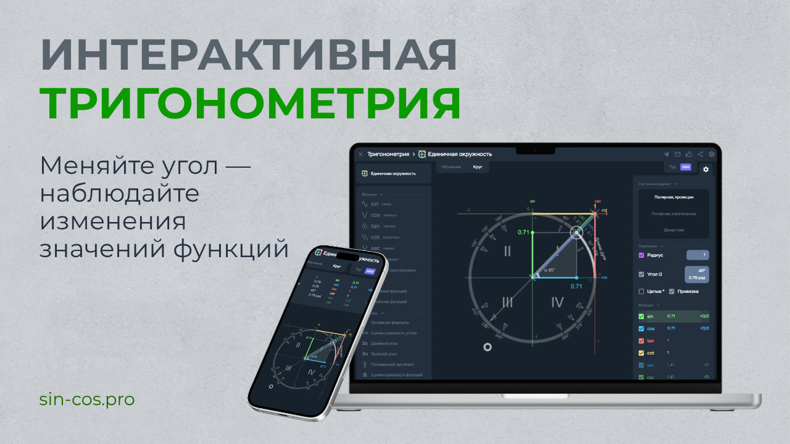

<h1 align="center">Антон Стуков</h1>

<strong>Разработчик сайтов и веб-инструментов</strong>

От лендингов и калькуляторов до интерактивных приложений и сервисов для бизнеса

### Обо мне

Помогаю превращать идеи в понятные цифровые продукты: уточняю задачу, продумываю сценарии и интерфейс, создаю работающую версию и проверяю результат. Использую ИИ как инструмент разработки.

### Технологии

### Как я работаю

**Задача.** Уточняю цель, сценарии и исходные данные.

**Решение.** Продумываю структуру и интерфейс, разрабатываю согласованные функции.

**Результат.** Показываю рабочую версию, проверяю её и передаю согласованные материалы.

### Проекты

  
  
  

**[sin-cos.pro](https://sin-cos.pro/)** — собственный образовательный сайт с интерактивной тригонометрической окружностью, графиками и справочными разделами.  
Мой вклад: идея, дизайн, разработка, тестирование, публикация и продвижение.

**[Калькулятор стоимости дома «УпрофДом»](https://amrakimmerian.gitverse.site/uprofdom-calculators/)** — веб-инструмент для предварительного расчёта и подготовки ответа клиенту.  
Мой вклад: уточнение исходных данных у специалиста, дизайн, UX, разработка и публикация.

**[MaPawTrip](https://mapawtrip.com/)** — командный проект платформы перевозки животных. Сайт временно недоступен: на нём ведётся техническое обслуживание.  
Мой вклад: участие в разработке интерфейса и серверной части, работа с данными и подключением сервисов. Дизайн подготовлен коллегой.

### Связаться со мной

